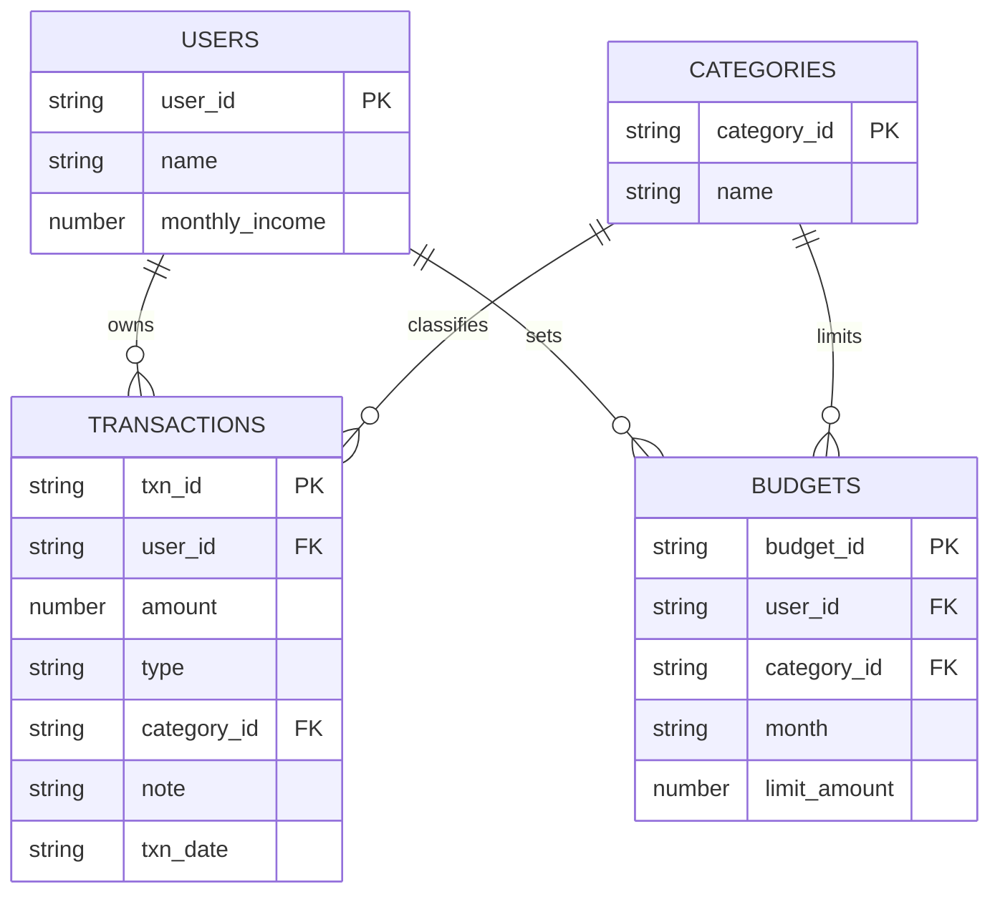

# PaisaPal — Personal Expense & Budget Coach

**Task:** T3  
**Agent name:** PaisaPal  
**Stack:** JavaScript (Node.js), MongoDB, LangChain

PaisaPal lets multiple users log income and expenses in plain English, inspect transactions, summarize monthly spending, set category budgets, check budget status, compare months, and delete mistaken entries only after confirmation.

## Requirements covered

- MongoDB collections: `users`, `categories`, `transactions`, `budgets`.
- Seed data: 3 users, 7 categories, 72 transactions spread over the last two months, and budgets for 5 categories per user.
- LangChain tool-calling agent; database reads/writes are implemented in named tools.
- Safe MongoDB driver methods and fixed query shapes; the model cannot execute arbitrary database queries.
- Relative dates are parsed with `chrono-node`.
- Missing amount/category should trigger a clarification rather than a guess.
- Warnings when a category uses 80% or more of its budget, and clear alerts above 100%.
- Delete tool requires explicit confirmation.
- Conversation history persists for the lifetime of the CLI session.
- `.env.example` is included; real secrets belong in `.env`.

## Setup

1. Install Node.js 20+ and MongoDB Community Server, or create a MongoDB Atlas database.
2. Install dependencies:

   ```bash
   npm install
   ```

3. Create your environment file:

   ```bash
   cp .env.example .env
   ```

   Add your `OPENAI_API_KEY`. Set `MONGODB_URI` if MongoDB isn't local.

4. Seed the database:

   ```bash
   npm run seed
   ```

5. Start PaisaPal:

   ```bash
   npm start
   ```

6. Select one of the demo users: `U101`, `U102`, or `U103`.

## Example requests

- `Spent 250 on pizza yesterday.`
- `How much did I spend on food this month?`
- `Set my shopping budget to 3000 for this month.`
- `Am I over budget anywhere?`
- `Compare my spending this month with last month and give me 3 saving tips.`
- `Show my transactions from 2026-10-01 to 2026-10-16.`

The agent may ask you to clarify an amount or category. It will ask for confirmation before deleting a transaction.

## Tools

| Tool | Purpose |
|---|---|
| `add_transaction` | Add an income or expense, then check the category budget |
| `list_transactions` | List transactions by date range, category, or type |
| `get_spending_summary` | Monthly category totals and percentage of total |
| `set_budget` | Create/update a monthly category budget |
| `check_budget_status` | Compare spent amount with monthly category limits |
| `delete_transaction` | Show transaction first, then delete only after confirmation |
| `compare_months` | Compare a month with the previous month |

## MongoDB collection design

See [`schema.js`](./schema.js). Indexes are created automatically by `src/db.js`.



## Project structure

```text
PaisaPal/
├── src/
│   ├── agent.js
│   ├── config.js
│   ├── dates.js
│   ├── db.js
│   ├── index.js
│   ├── seed.js
│   ├── systemPrompt.js
│   └── tools.js
├── .env.example
├── .gitignore
├── package.json
├── schema.js
├── README.md
└── test_prompts.md
```

## Notes

- All monetary amounts are stored as positive numbers; `type` distinguishes `INCOME` from `EXPENSE`.
- This is a hackathon starter, not a production finance app. Add authentication, authorization, validation tests, rate limiting, and backups before real-world deployment.
- The seed script resets the four PaisaPal collections before inserting demo data. Do not run it against a database containing data you want to keep.
